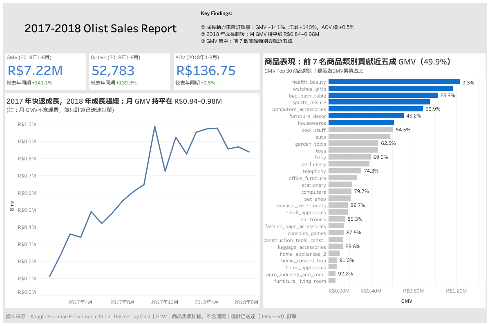

## Key Findings

## Tableau Dashboard

[查看互動版 dashboard（Tableau Public）](https://public.tableau.com/app/profile/.57596212/viz/OlistSalesReport/Sales_Overview)

### 1. 成長來自訂單量，而非客單價

進一步拆解GMV ＝ Orders × AOV，分別看訂單和客單價的變化趨勢來回答GMV的成長動力。2018 年 1–8 月 GMV 較去年同期成長 **141%**，其中訂單數成長 **140%**，客單價（AOV）僅成長 **0.5%**（136.08 → 136.75），成長幾乎完全來自訂單量增加，平均每張訂單的消費金額變動不大。

**建議行動方向**：客單價是尚未被開發的成長槓桿。可以測試組合優惠、
滿額免運門檻等提升客單價的做法，並用 A/B test 驗證效果。

### 2. 進入2018年後成長有放緩趨勢

2017 年月訂單數從 750 張快速成長到 4,000 張以上；
但 2018 年 1–8 月每月訂單數停留在 **6,100–7,100 張**，
8 月訂單數與 GMV 甚至比 1 月低約 **10%**。

GMV 年增率也從 2018 年 1 月的 **727%** 降到 8 月的 **51%**。
其中一部分來自基期效應（2017 年初平台規模小），
但結合 2018 年月銷售持平的趨勢，可以判斷成長動能確實在減弱。

另外，2017 年 11 月（Black Friday）GMV 較前月成長 **52%**，
是資料期間的單月最高峰，12 月則回落 26%，顯示明顯的季節性。

**建議行動方向**：成長重心可以從獲取新客逐步轉向既有顧客的忠誠度與回購

### 3. GMV貢獻集中於少數商品品類

分析範圍內共計 73 個商品類別（不含缺類別資料的商品），第 1 名 health_beauty 即占 GMV 的 **9.3%**，
前 7 名合計約 **50%**、前 20 名約 **84%**。

**建議行動方向**：持續維護與熱賣商品的供應商穩定的合作，重新檢視冷門商品的市場定位，考慮更換合作賣家或汰換成新品實驗
